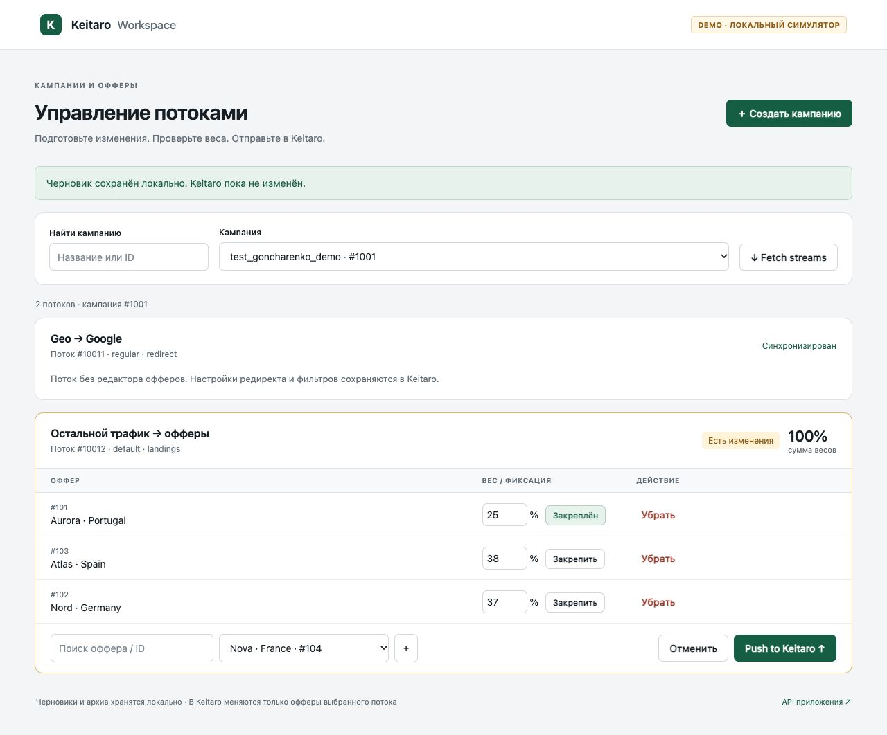

# Keitaro Workspace

Небольшая обёртка над Keitaro: создание кампании с геофильтром и редактор офферов с локальными черновиками.

**FastAPI · SQLAlchemy 2 · Alembic · SQLite · HTML/CSS/JavaScript**



## Запуск за минуту

Нужен Python 3.12. Команды выполняются из корня репозитория.

```bash
python3.12 -m venv .venv
source .venv/bin/activate
pip install -r requirements.txt
cp .env.example .env
alembic upgrade head
uvicorn app.main:create_app --factory --host 127.0.0.1 --port 8000
```

Откройте http://127.0.0.1:8000. По умолчанию включён **DEMO**: локальный симулятор с пятью офферами и готовой кампанией. Он сохраняет состояние в `.demo-keitaro.json` и не обращается к внешнему API. Черновики приложения хранятся отдельно, в `keitaro.db`.

## Подключение к Keitaro

В локальном `.env`:

```dotenv
DEMO_MODE=false
KEITARO_URL=https://your-tracker.example
KEITARO_API_KEY=your-existing-api-key
DATABASE_URL=sqlite:///./keitaro.db
CAMPAIGN_PREFIX=test_goncharenko_
```

Перезапустите приложение. Адрес указывается без `/admin/` и `/admin_api/v1/`. Ключ передаётся сервером в заголовке `Api-Key`, в браузер не попадает. `.env`, базы данных и состояние симулятора исключены из Git. Для демонстрации и live-режима используйте разные файлы БД, например `sqlite:///./demo.db` и `sqlite:///./live.db`.

Доступу нужны чтение кампаний, потоков, офферов, доменов, групп, источников и создание/изменение кампаний и потоков. Глобальные офферы приложение не создаёт и не удаляет.

## Что реализовано

### Создание кампании

1. Введите название с префиксом `test_goncharenko_`, ISO-код страны, выберите оффер, домен, группу и источник.
2. Приложение проверит идентификаторы и создаст выключенную кампанию с ротацией по позиции.
3. Первый поток `regular`: фильтр `country / accept`, редирект на `https://www.google.com/`.
4. Второй поток `default`: оставшийся трафик направляется в выбранный оффер с весом 100%.
5. После создания обоих потоков кампания включается. При частичном сбое возвращается ID созданной кампании. Слепых повторов POST нет: таймаут не означает, что сервер ничего не создал.

### Редактор

- **Fetch streams** импортирует потоки и связи офферов в локальную БД. Повторный импорт блокируется при наличии черновиков.
- Потоки без офферов отображаются без редактора. Фильтры, редиректы и лендинги не редактируются.
- Поиск офферов работает по названию и ID. Добавление, удаление и возврат автоматически пересчитывают свободные веса.
- Чтобы закрепить процент, введите число и нажмите **Закрепить**. Закреплённые веса сохраняются при изменении состава; остаток делится между остальными.
- Веса целочисленные: для трёх офферов `34 / 33 / 33`; при закреплённых 25% оставшиеся получают `38 / 37`. Порядок распределения остатка стабилен. Сумма — ровно 100%.
- **Убрать** помечает связь серым и обнуляет её вес. До отправки это только черновик. После отправки связь исчезает из Keitaro, но остаётся в локальном архиве.
- **Вернуть** восстанавливает архивную связь в черновике. **Отменить** возвращает последнее импортированное или отправленное состояние, включая фиксации и архив; новые черновые связи исчезают.
- **Push to Keitaro** отправляет только список офферов выбранного потока. Все прочие поля остаются нетронутыми.
- Перед отправкой приложение перечитывает поток. Если состав, веса, состояния офферов или схема изменились снаружи, вернётся конфликт 409. Отмените черновик, выполните Fetch и повторите правки.
- При Fetch связи, удалённые снаружи, переходят в локальный архив. Их можно вернуть. Удалённые целиком потоки удаляются из локального списка.
- Пустой состав нельзя отправить. Дубли офферов, неверные проценты и несовместимые фиксации отклоняются.

## Быстрая проверка в DEMO

1. В готовой кампании закрепите первый оффер на 25%.
2. Найдите третий оффер и добавьте его: получится `25 / 38 / 37`. Поток помечен «Есть изменения».
3. Нажмите «Отменить»: вернутся два оффера по 50%.
4. Повторите добавление и нажмите Push. Затем уберите оффер и отправьте изменения. Он останется серой строкой в архиве.
5. Выполните Fetch и верните архивный оффер. После перезапуска приложения локальные черновики и архив сохранятся.

## Архитектура

```text
Браузер → FastAPI → SQLAlchemy / SQLite
                   ↳ HTTP-клиент → Keitaro Admin API
```

В таблице `streams` одна запись на удалённый поток. `remote` хранит снимок ответа Keitaro, `published` — последнее подтверждённое локальное состояние, `draft` — текущую правку. Каждый состав содержит ID оффера, имя, вес, фиксацию, признак архива и данные удалённой связи. JSON здесь позволяет сохранять метаданные связи без зависимости схемы БД от версии Keitaro. Поле `version` защищает от записи из устаревшей вкладки. SQLAlchemy дополнительно проверяет версию при UPDATE.

Файлы:

- `app/main.py` — HTTP API и операции над черновиками;
- `app/keitaro.py` — реальный клиент и локальный симулятор;
- `app/weights.py` — распределение весов и сравнение удалённых связей;
- `app/models.py` — модель хранения;
- `app/static/` — интерфейс без сборки и CDN;
- `migrations/` — миграция таблицы и индекса;
- `tests/` — сценарные проверки API, клиента и весов.

API приложения доступен на `/docs`.

## Миграции и тесты

```bash
alembic upgrade head
python -m pytest -q
```

Тесты используют временные SQLite-базы, применяют настоящую Alembic-миграцию и не обращаются к внешнему Keitaro. Проверяются полный цикл черновика, фиксации, отмена, архив и возврат, сохранение после перезапуска, внешнее удаление, устаревшая вкладка, конфликт перед Push, частичное создание кампании, ошибки клиента, отсутствие автоматического повтора POST и целочисленная сумма весов для 1–200 офферов.

Для отката локальной схемы: `alembic downgrade base`. **Откат удаляет таблицу вместе с локальными черновиками и архивом**, поэтому перед ним сделайте копию БД. Удалённый Keitaro миграции не меняют.

## Проверка с реальным API

20 ноября 2026 приложение создало тестовую кампанию `test_goncharenko_workspace_20261120`, ID `216694`: домен, группа, источник, геопоток PT → Google и резервный поток с оффером. Проверка отправки списка офферов и повторного импорта описана в `VALIDATION.md`.

## Границы решения

Это локальный инструмент для тестового задания: запускать **одним worker на 127.0.0.1**. Авторизация пользователей и разграничение прав не добавлены; перед размещением в сети нужны аутентификация и HTTPS. Cross-origin запись заблокирована, интерфейс не загружает сторонние скрипты. API-ключ остаётся на сервере.

Проверка перед Push снижает риск перезаписи чужих изменений, но между GET и PUT остаётся окно гонки: атомарного compare-and-swap у используемого Keitaro API нет. Поддержка нескольких процессов потребует блокировок в БД и очереди синхронизации. Запросы имеют таймаут; автоматических повторов изменяющих запросов нет. При неоднозначном результате нужно перечитать Keitaro, затем продолжать.

Документация использованного API: [Keitaro Admin API](https://admin-api.docs.keitaro.io/).
